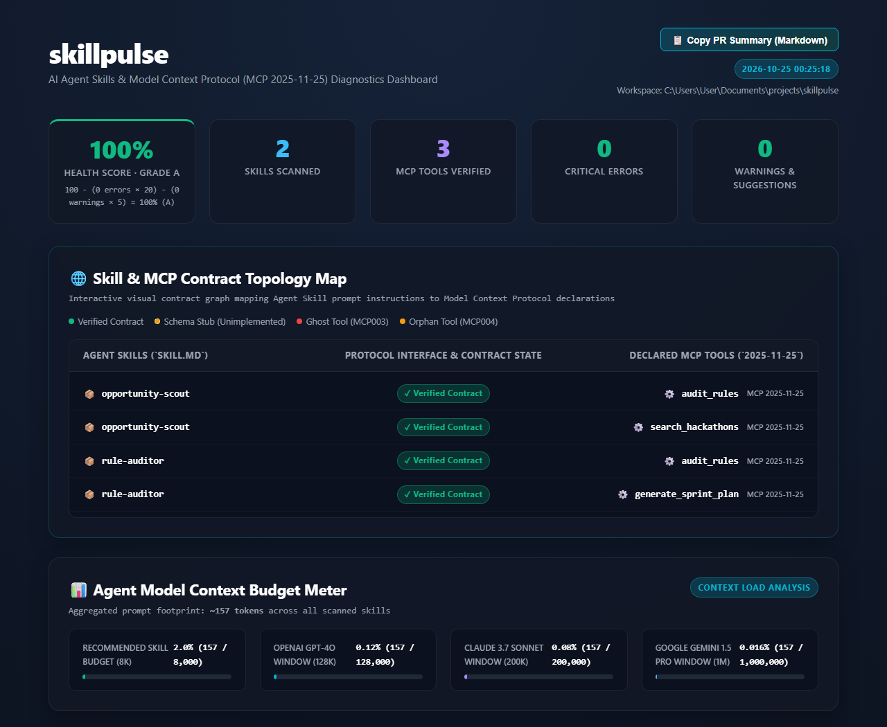
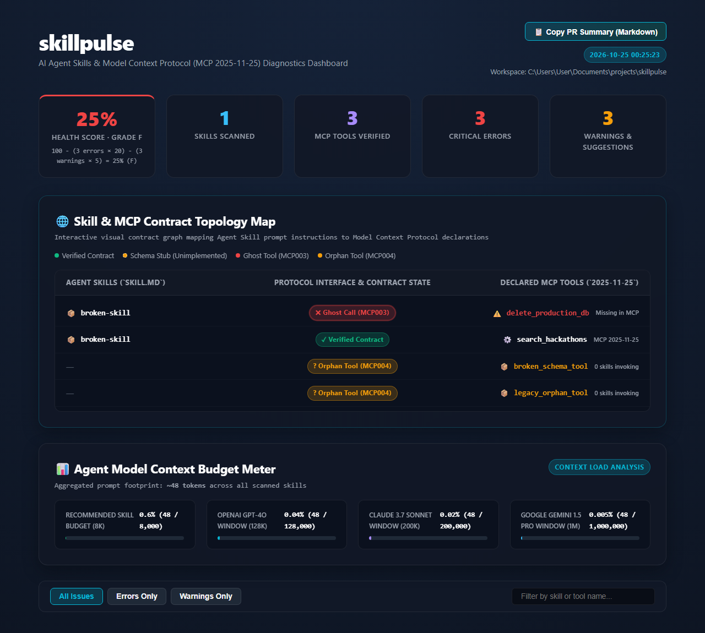
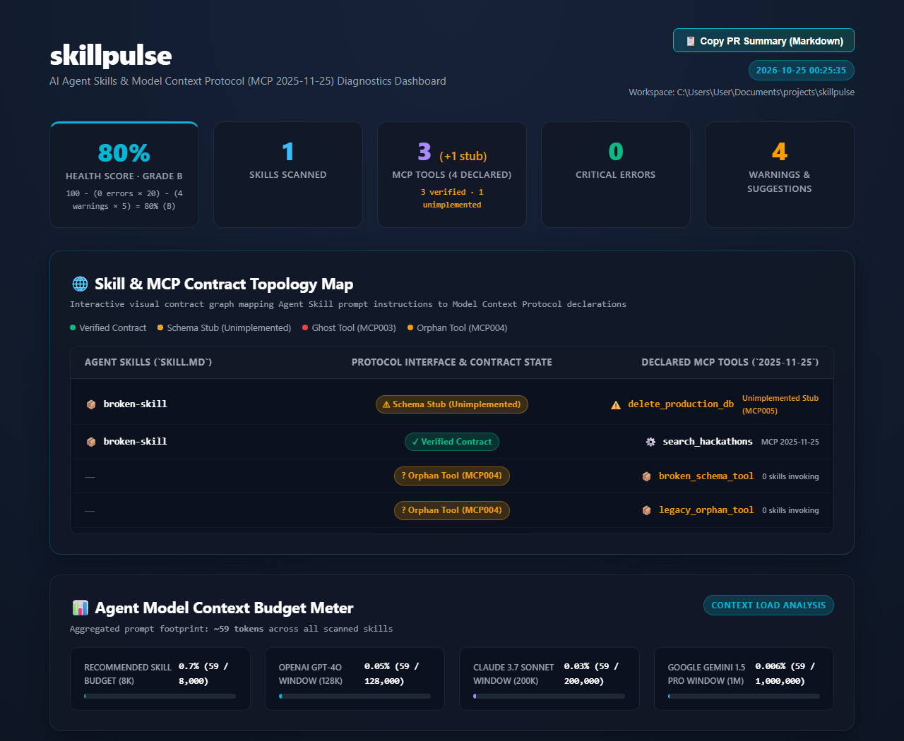
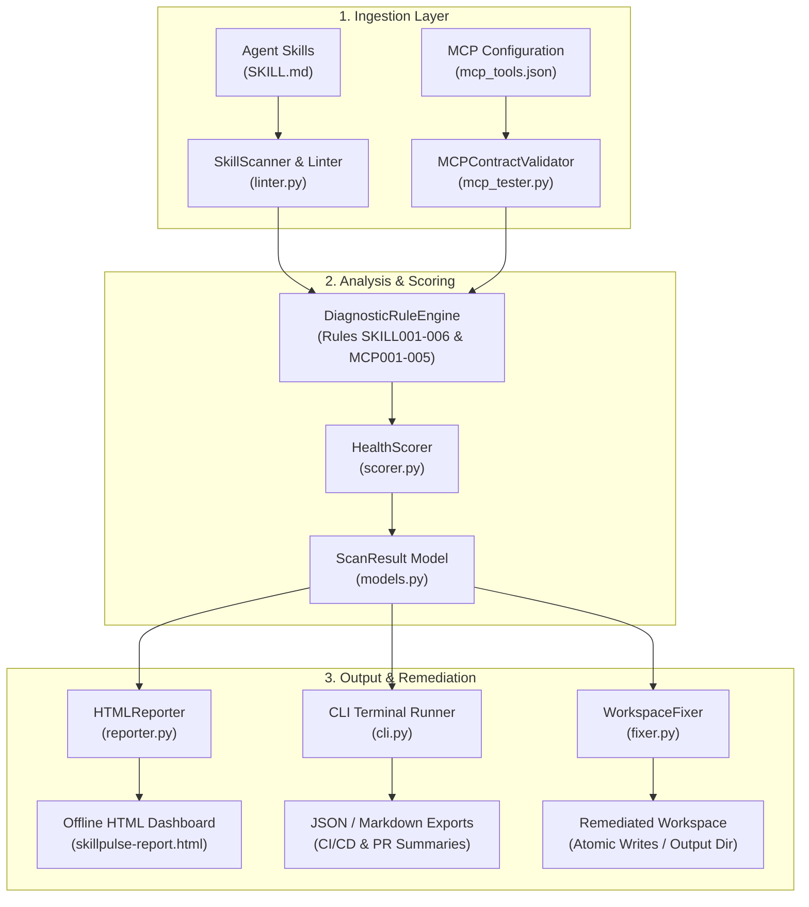

# SkillPulse

[](LICENSE)
[](https://www.python.org/)
[](https://spec.modelcontextprotocol.io)
[](tests/)
[](pyproject.toml)

> **AI Agent Skills & MCP Contract Analyzer**  
> Statically analyzes Agent Skills (`SKILL.md`) and Model Context Protocol (`MCP 2025-11-25`) tool manifests to identify contract mismatches, schema defects, token bloat, and orphaned tools before deployment.

Built for **Syntax Error 2026 on Devfolio**.

---

## The Problem

As autonomous coding agents (Claude Code, Antigravity, Cursor, OpenAI Codex) proliferate, developers increasingly rely on two foundational specifications:
1. **Agent Skills (`SKILL.md`):** Prompt instructions, activation guidelines, and tool-use cues that steer agent behavior.
2. **Model Context Protocol (`MCP 2025-11-25`):** Standardized JSON tool contracts that declare callable client and server tools.

In practice, these two layers are authored independently and evolve asynchronously. This disconnect leads to silent, expensive failures:

* **Ghost Tools:** Skill instructions prompt the agent to call tools (e.g. `delete_production_db`, `query_user_by_id`) that are absent from the MCP server manifest. The model hallucinates calls or terminates execution.
* **Orphaned / Undocumented Tools:** MCP servers declare tools with complex schemas, but prompt instructions never explain when or how to invoke them, leaving valuable integrations unused.
* **Invalid Tool Schemas:** Declared tools lack required `inputSchema` objects, omit parameter types, or fail JSON Schema Draft 7 specifications, causing runtime client deserialization errors.
* **Context-Window Bloat:** Prompts balloon in token footprint without notice, silently exhausting the model's effective attention span and increasing operational inference costs.
* **Placeholder Schema Blind Spots:** Auto-generated tool stubs are easily mistaken for genuinely implemented server code, leading to false confidence prior to deployment.

> **Scope Note:** SkillPulse is a **static analysis linter and contract analyzer**. It does not spawn autonomous runtime agents or execute live server subprocesses; instead, it validates schema contracts and prompt references deterministically in sub-millisecond execution.

---

## How SkillPulse Works

SkillPulse executes in a fast, deterministic five-stage pipeline:

```
┌─────────────────────────┐     ┌────────────────────────┐
│ Agent Skills (SKILL.md) │     │ MCP Manifests (.json)  │
└────────────┬────────────┘     └───────────┬────────────┘
             │                              │
             ▼                              ▼
    [ SkillScanner & Linter ]      [ MCP Contract Validator ]
             │                              │
             └──────────────┬───────────────┘
                            ▼
              [ Rule Evaluation & Cross-Check ]
              (SKILL001-006 & MCP001-005)
                            │
                            ▼
               [ Health Scorer (0-100%) ]
                            │
             ┌──────────────┴──────────────┐
             ▼                             ▼
   [ CLI / JSON / Markdown ]    [ Workspace Auto-Fixer ]
   [ Offline HTML Dashboard ]   (Atomic Schema & Stub Fixes)
```

1. **Ingestion & Discovery:** Scans the target workspace to discover all `SKILL.md` skill definitions and candidate MCP manifests (`mcp_tools.json`, `mcp.json`, `claude_desktop_config.json`).
2. **Static Inspection & Cross-Contract Parsing:** Extracts YAML frontmatter attributes, calculates heuristic token footprints (~1.3 tokens/word), validates input schemas against MCP 2025-11-25 specifications, and extracts referenced tools.
3. **Cross-Contract Evaluation:** Evaluates rules `SKILL001`–`SKILL006` and `MCP001`–`MCP005`, identifying ghost tool invocations, schema malformations, and orphaned declarations.
4. **Deterministic Health Scoring:** Calculates an objective 0–100% ecosystem health score and letter grade (A/B/C/D/F).
5. **Reporting & Remediation:** Emits ANSI terminal outputs, machine-readable JSON, PR Markdown summary tables, or an offline single-file HTML dashboard with an interactive contract topology map. Optionally, `skillpulse fix` auto-patches broken schemas and generates tagged placeholder stubs.

---

## Features

### 1. Agent Skill (`SKILL.md`) Static Analysis
* Parses YAML frontmatter between `---` delimiters using standard library parsers with fallback line-by-line recovery.
* Enforces required attributes (`name`, `description`), name constraints (1–64 characters, lowercase alphanumeric/hyphens), and trigger activation cues.
* Verifies local relative markdown links against filesystem contents to prevent dead-end instructions.
* Estimates token consumption to alert developers before prompts cause context bloat.

### 2. MCP 2025-11-25 Contract & Schema Validation
* Validates MCP tool arrays and wrapper envelopes (`{"tools": [...]}` or direct lists).
* Enforces JSON Schema Draft 7 / MCP standards: required `name`, `description`, `inputSchema` with `type: "object"`, parameter properties, and required property lists.
* Cross-checks prompt tool references against declared MCP tools to flag Ghost Tools and Orphaned Tools.
* Distinguishes structurally valid placeholder stubs (`MCP005`) from implemented server code.

### 3. Diagnostic Rules Reference

| Rule ID | Severity | Penalty | Name | Description |
| :--- | :--- | :--- | :--- | :--- |
| `SKILL001` | **ERROR** | -20 pts | Frontmatter Delimiters | Prompt file must begin and end with valid `---` YAML frontmatter delimiters. |
| `SKILL002` | **ERROR** | -20 pts | Skill Name | Attribute `name` is required (1–64 characters, lowercase alphanumeric and hyphens). |
| `SKILL003` | **ERROR** | -20 pts | Skill Description | Attribute `description` is required (must provide a clear, action-oriented purpose). |
| `SKILL004` | **WARNING** | -5 pts | Trigger Guidance | Emits warning if explicit activation keywords or trigger cues are missing from instructions. |
| `SKILL005` | **WARNING** | -5 pts | Token Budget | Flags prompts exceeding 2,500 estimated tokens (~1.3 tokens/word) to prevent context bloat. |
| `SKILL006` | **WARNING** | -5 pts | Broken File Link | Flags local relative markdown links pointing to non-existent files on disk. |
| `MCP001` | **ERROR** | -20 pts | Protocol Format | Requires valid MCP 2025-11-25 tool structure (array of tool objects). |
| `MCP002` | **ERROR** | -20 pts | Schema Completeness | Tools require `name`, `description`, and `inputSchema` with `type: "object"`. |
| `MCP003` | **ERROR** | -20 pts | Ghost Tool Detection | Flags tools called in skill prompts that are not declared in MCP manifests. |
| `MCP004` | **WARNING** | -5 pts | Orphaned Tool | Flags declared MCP tools that are never referenced across any agent skill prompts. |
| `MCP005` | **WARNING** | -5 pts | Placeholder Stub | Flags tools containing `"x_skillpulse_stub": true` or `[AUTO-GENERATED STUB]` in description. |

### 4. Deterministic Workspace Auto-Fixer (`skillpulse fix`)
* **Schema Repairs (`MCP002`):** Repairs missing or invalid `inputSchema` definitions by generating compliant `{"type": "object", "properties": {}, "required": []}` structures.
* **Frontmatter Description Ingestion (`SKILL003`):** Injects compliant default descriptions into invalid skill frontmatter.
* **Ghost Tool Stub Generation (`MCP003`):** Synthesizes compliant MCP 2025-11-25 placeholder stubs for undeclared tools, explicitly tagged with `"x_skillpulse_stub": true` so they are audited as stubs (`MCP005`) rather than counted as verified production implementations.
* **Atomic Writes & Safe Simulation:**
  * `--dry-run`: Simulates all proposed actions, displaying diff summaries without writing to disk.
  * `--output-dir <path>`: Clones the target workspace to a new folder and applies fixes there, leaving original fixtures untouched.

### 5. Offline Interactive HTML Dashboard
* **Self-Contained Single File:** Zero external CDN links, tracking scripts, or dependencies. Works completely offline via `file://`.
* **Contract Topology Map:** Visual matrix linking agent skills to MCP tools, color-coding contract states:
  * `✓ Verified Contract` (emerald) — Active reference matched to a valid MCP tool.
  * `⚠ Schema Stub (Unimplemented)` (amber) — Schema exists but is explicitly tagged as a placeholder.
  * `✖ Ghost Call (MCP003)` (rose) — Tool called by prompt but missing from MCP manifest.
  * `? Orphan Tool (MCP004)` (amber) — Declared MCP tool unreferenced by any skill.
* **Context Budget Meter:** Comparative visualizer mapping total skill prompt tokens against major LLM context windows (GPT-4o 128k, Claude 3.7 Sonnet 200k, Gemini 1.5 Pro 1M).
* **Safe Clipboard Actions:** 1-click clipboard buttons for GitHub PR Markdown summaries and per-issue remediation snippets using Base64-encoded `data-fix-b64` attributes and `document.execCommand` fallbacks for 100% reliable copying in `file://` contexts.

### 6. CI/CD & Headless Integration
* `--format json`: Emits machine-readable JSON output for automated CI pipelines.
* `--format markdown`: Generates a GitHub PR / GitLab MR summary comment table.
* `--json-output <path>`: Persists raw scan results independently to disk.
* `skillpulse report --from-json <path>`: Rehydrates and compiles a full visual HTML dashboard directly from a saved JSON artifact without needing access to the original source tree.

---

## Ecosystem Health Scoring

SkillPulse implements a transparent, deterministic scoring engine. Every scan begins with a baseline score of 100 points:

$$\text{Health Score} = \max\left(0,\, 100 - (20 \times \text{errors}) - (5 \times \text{warnings})\right)$$

### Grade Boundaries

| Grade | Score Range | Description | CI Status |
| :---: | :---: | :--- | :---: |
| **A** | **90% – 100%** | Excellent Health — Clean contracts, no critical errors | **PASS** |
| **B** | **80% – 89%** | Good Health — Minor warnings or non-blocking placeholder stubs | **PASS** |
| **C** | **70% – 79%** | Needs Improvement — Multiple warnings detected | **REVIEW** |
| **D** | **60% – 69%** | Marginal — Moderate issues detected across contracts | **REVIEW** |
| **F** | **< 60%** | Failing — Critical errors present (broken schemas, ghost tools, or malformed YAML) | **FAIL (Exit 1)** |

> **Score Limitation:** The health score is a deterministic project indicator designed for CI quality gates and contract consistency. It is not an industry-wide certified benchmark and does not guarantee that external servers execute without runtime errors.

---

## Demonstration Scenarios & Acceptance Baseline

The repository includes reproducible reference workspaces under [`examples/`](examples) demonstrating SkillPulse's diagnostic and remediation capabilities:

| Workspace | Initial Score | Post-Fix Score | Observed Behavior |
| :--- | :---: | :---: | :--- |
| **Healthy Workspace**<br>[`examples/healthy_workspace`](examples/healthy_workspace) | **100% (Grade A)**<br>(0 errors, 0 warnings) | N/A | Reference baseline. 2 skills, 3 tools, verified topology links. Clean CI pass. |
| **Broken Workspace**<br>[`examples/broken_workspace`](examples/broken_workspace) | **25% (Grade F)**<br>(3 errors, 3 warnings) | N/A | Contains missing frontmatter description (`SKILL003`), broken relative link (`SKILL006`), broken tool schema (`MCP002`), ghost tool `delete_production_db` (`MCP003`), and 2 orphan tools (`MCP004`). |
| **Remediated Workspace**<br>(Fixed via `skillpulse fix`) | N/A | **80% (Grade B)**<br>(0 errors, 4 warnings) | `SKILL003` and `MCP002` repaired; ghost tool converted to a tagged placeholder stub. The remaining warnings (broken link, 2 orphans, and 1 stub) reflect intentional transparency: stubs are scored as `MCP005` (-5 pts) rather than falsely counted as operational code. |

### Visual Dashboard Screenshots

The self-contained, offline HTML dashboard (`skillpulse-report.html`) visualizes the contract topology matrix, context budget consumption, and diagnostic findings:

#### 1. Healthy Workspace (100% Grade A — CI Ready Baseline)
Clean verification showing 0 errors, 0 warnings, and active green verified contract links between skills and declared MCP tools:


#### 2. Broken Workspace (25% Grade F — Critical Contract Errors)
Surfaces missing frontmatter, broken schemas, orphaned tools, and an immediate red `✖ Ghost Call (MCP003)` for undefined tools:


#### 3. Remediated Workspace (80% Grade B — Fixed Schemas & Tagged Stubs)
After running `skillpulse fix`, broken schemas are repaired and undeclared tools are stubbed. The amber `⚠ Schema Stub (Unimplemented)` edge explicitly informs developers that server implementation is required before production deployment:


---

## Installation & Usage

### Prerequisites
* **Python 3.10 or higher**
* **Zero External Runtime Dependencies:** SkillPulse uses only standard library modules (`json`, `pathlib`, `re`, `argparse`, `dataclasses`, `html`, `base64`, `shutil`). `pytest` is only required to run the automated test suite.

### Installation

```powershell
# Clone the repository
git clone https://github.com/Zenfox-690/skillpulse.git
cd skillpulse

# (Optional) Create and activate a virtual environment
python -m venv .venv
.venv\Scripts\Activate.ps1    # Windows PowerShell
# source .venv/bin/activate    # Linux / macOS

# Install in editable mode (or run directly with python -m skillpulse)
pip install -e .
```

### CLI Command Reference

```powershell
# 1. Run a full workspace scan (Skills + MCP)
python -m skillpulse scan

# 2. Scan specific directories and configuration paths
python -m skillpulse scan --skills-dir examples/healthy_workspace/skills --mcp-config examples/healthy_workspace/mcp_tools.json

# 3. Generate a self-contained visual HTML dashboard
python -m skillpulse scan --report artifacts/health_dashboard.html

# 4. Output machine-readable JSON for CI pipelines
python -m skillpulse scan --format json

# 5. Output GitHub PR / GitLab MR summary table in Markdown
python -m skillpulse scan --format markdown

# 6. Save scan results independently to a JSON file
python -m skillpulse scan --json-output artifacts/scan_results.json

# 7. Rehydrate and compile an HTML dashboard from a saved JSON artifact
python -m skillpulse report --from-json artifacts/scan_results.json --output artifacts/rehydrated_report.html

# 8. Simulate auto-fixer in dry-run mode (no files modified)
python -m skillpulse fix examples/broken_workspace --dry-run

# 9. Apply fixes safely to a cloned target output directory
python -m skillpulse fix examples/broken_workspace --output-dir temp_fixed_workspace

# 10. Lint Agent Skills only
python -m skillpulse lint-skills examples/healthy_workspace/skills

# 11. Validate MCP tool schemas and contracts only
python -m skillpulse test-mcp examples/sample_mcp_tools.json
```

---

## Command-Line Example

Running a scan on a broken workspace surfaces critical errors and generates remediation recommendations:

```text
$ python -m skillpulse scan --skills-dir examples/broken_workspace/skills --mcp-config examples/broken_workspace/mcp_tools.json

  ___ _   _ _ _                 _          
 / __| |_(_) | |_ __ _  _ | |___ ___ 
 \__ \ / / | | | '_ \ || | | (_-< / -_)
 |___/_\_\_|_|_| .__/\_,_|_|_/__/_\___|
               |_|                     
 AI Agent Skills & MCP (2025-11-25) Linter & Test Harness

=== Agent Skills Validation ===

  [FAIL] broken-skill (~48 tokens)
    Path: examples\broken_workspace\skills\broken-skill\SKILL.md
    Referenced Tools: delete_production_db, search_hackathons
    [ERROR] SKILL003: Missing required frontmatter attribute 'description'.
      -> Fix: Add 'description: Clear, action-oriented purpose of this skill' to frontmatter.
    [WARN]  SKILL006: Broken relative file link: 'references/missing.md' does not exist on disk.
      -> Fix: Verify target file 'references/missing.md' exists relative to 'broken-skill'.

  Summary: 1 skills checked, 1 errors, 1 warnings.

=== Model Context Protocol (MCP 2025-11-25) Validation ===

  Source: examples\broken_workspace\mcp_tools.json
  Protocol Standard: 2025-11-25
  Declared Tools (3):
    * search_hackathons (query)
    * broken_schema_tool (no params)
    * legacy_orphan_tool (flag)

  Ghost Tools Detected (1):
    ! delete_production_db (referenced in skills, but missing in MCP tools)

  Orphaned / Undocumented Tools (2):
    ? broken_schema_tool (declared in MCP, never referenced in skills)
    ? legacy_orphan_tool (declared in MCP, never referenced in skills)

  Diagnostics:
    [ERROR] MCP002: MCP tool 'broken_schema_tool' is missing required 'inputSchema' object.
      -> Fix: Add 'inputSchema: {"type": "object", "properties": {}}' adhering to MCP 2025-11-25.
    [ERROR] MCP003: Ghost Tool detected: 'delete_production_db' is referenced in skill(s) [broken-skill] but is not declared in MCP tools.
      -> Fix: Define 'delete_production_db' in your MCP server tool manifest or correct the skill prompt instructions.
    [WARN]  MCP004: Orphan MCP tool: 'broken_schema_tool' is declared in MCP tools but never referenced in any Agent Skill.
      -> Fix: Document 'broken_schema_tool' in an agent skill prompt so agents know when to invoke it.
    [WARN]  MCP004: Orphan MCP tool: 'legacy_orphan_tool' is declared in MCP tools but never referenced in any Agent Skill.
      -> Fix: Document 'legacy_orphan_tool' in an agent skill prompt so agents know when to invoke it.

  Summary: 3 tools validated, 2 errors, 2 warnings.

====================================================
  Ecosystem Health Score: 25% (F)
  Grade F (Failing - 3 Critical Error(s) Present)
  Score Formula: 100 - (3 errors × 20) - (3 warnings × 5) = 25% (F)
  Total Critical Errors: 3
  Total Warnings: 3
  Ghost Tools: 1 | Orphan Tools: 2 | Schema Stubs: 0
====================================================
```

---

## Architecture & Data Flow

SkillPulse follows a modular, single-responsibility architecture implemented entirely within standard Python library boundaries:



### Module Responsibilities

* **`skillpulse.models`:** Immutable dataclasses (`DiagnosticIssue`, `SkillReport`, `MCPTool`, `MCPReport`, `ScanResult`) with bidirectional JSON serialization via `to_dict()` and `from_dict()`.
* **`skillpulse.linter`:** Frontmatter extraction, relative link validation, token estimation, and prompt tool reference extraction.
* **`skillpulse.mcp_tester`:** JSON Schema validation against MCP 2025-11-25 specifications, cross-contract referencing, and `MCP005` stub detection.
* **`skillpulse.scorer`:** Deterministic scoring logic, formula formatting, and letter grade assignment.
* **`skillpulse.fixer`:** Atomic disk writes, dry-run simulation, and deterministic patching (`SKILL003`, `MCP002`, `MCP003`).
* **`skillpulse.reporter`:** Standalone HTML compilation, CSS/SVG layout, contract topology matrix, context budget meters, and safe Base64 clipboard actions.
* **`skillpulse.cli`:** Unified CLI dispatcher, ANSI terminal rendering, and POSIX exit code management.

---

## Limitations & Future Work

### Current Limitations
* **Static Analysis vs. Runtime Verification:** SkillPulse statically validates schemas and prompts. It does not spawn live MCP subprocesses or send network requests to external servers, meaning it cannot detect server-side internal exceptions thrown during dynamic tool execution.
* **Token Estimation Heuristic:** Token consumption is estimated at ~1.3 tokens per whitespace-delimited word. While accurate within ~5% for English prose instructions, exact BPE tokenization varies slightly across specific model tokenizers (e.g. `cl100k_base` vs. `o200k_base`).
* **Auto-Fixer Scope:** `skillpulse fix` automates structural remediations (frontmatter injection, schema structure repair, stub generation). It intentionally does not attempt to write server business logic or synthetic Python/TypeScript execution code for tools.

### Planned Enhancements
* **Dynamic Stdio / SSE Probe Mode:** An optional opt-in flag to probe running MCP servers via standard I/O to verify that declared tools return valid responses at runtime.
* **Automated GitHub Action:** A packaged reusable GitHub Action to post PR comments and enforce health score gates automatically in CI pipelines.
* **Multi-Manifest Aggregation:** Support for scanning distributed server configurations across nested microservice repositories.

---

## Automated Test Suite

SkillPulse is thoroughly tested using `pytest`. All 45 test cases pass cleanly with zero warnings or failures:

```powershell
python -m pytest tests/ -v
```

```text
============================= test session starts =============================
platform win32 -- Python 3.13.13, pytest-9.1.1, pluggy-1.7.0
rootdir: C:\Users\User\Documents\projects\skillpulse
configfile: pyproject.toml
collected 45 items

tests/test_cli.py::test_cli_lint_skills_valid PASSED                     [  2%]
tests/test_cli.py::test_cli_lint_skills_invalid PASSED                   [  4%]
tests/test_cli.py::test_cli_test_mcp_valid PASSED                        [  6%]
tests/test_cli.py::test_cli_scan_full PASSED                             [  8%]
tests/test_cli.py::test_cli_healthy_workspace PASSED                     [ 11%]
tests/test_cli.py::test_cli_broken_workspace PASSED                      [ 13%]
tests/test_linter.py::test_valid_skill PASSED                            [ 15%]
tests/test_linter.py::test_missing_frontmatter_delimiter PASSED          [ 17%]
tests/test_linter.py::test_missing_name_attribute PASSED                 [ 20%]
tests/test_linter.py::test_missing_description_attribute PASSED          [ 22%]
tests/test_linter.py::test_trigger_guidance_warning PASSED               [ 24%]
tests/test_linter.py::test_token_budget_estimation PASSED                [ 26%]
tests/test_linter.py::test_yaml_parser_inline_lists PASSED               [ 28%]
tests/test_linter.py::test_scanner_finds_skills PASSED                   [ 31%]
tests/test_linter.py::test_broken_relative_markdown_link PASSED          [ 33%]
tests/test_linter.py::test_tool_extraction_does_not_extract_sibling_skills_or_generic_backticks PASSED [ 35%]
tests/test_mcp_tester.py::test_valid_mcp_tools PASSED                    [ 37%]
tests/test_mcp_tester.py::test_invalid_mcp_format PASSED                 [ 40%]
tests/test_mcp_tester.py::test_missing_fields_and_schema_types PASSED    [ 42%]
tests/test_mcp_tester.py::test_ghost_tool_cross_checking PASSED          [ 44%]
tests/test_mcp_tester.py::test_orphan_tool_detection PASSED              [ 46%]
tests/test_mcp_tester.py::test_malformed_json_file PASSED                [ 48%]
tests/test_mcp_tester.py::test_config_discovery PASSED                   [ 51%]
tests/test_mcp_tester.py::test_unimplemented_stub_detection PASSED       [ 53%]
tests/test_reporter.py::test_generate_html_creates_valid_file PASSED     [ 55%]
tests/test_reporter.py::test_copy_snippet_escaping_and_base64_remediation PASSED [ 57%]
tests/test_scorer.py::test_perfect_score PASSED                          [ 60%]
tests/test_scorer.py::test_single_error_penalty PASSED                   [ 62%]
tests/test_scorer.py::test_single_warning_penalty PASSED                 [ 64%]
tests/test_scorer.py::test_grade_d_boundary PASSED                       [ 66%]
tests/test_scorer.py::test_combined_penalties PASSED                     [ 68%]
tests/test_scorer.py::test_floor_at_zero PASSED                          [ 71%]
tests/test_scorer.py::test_format_formula PASSED                         [ 73%]
tests/test_scorer.py::test_score_scan_integration PASSED                 [ 75%]
tests/test_upgrades.py::test_models_from_dict_roundtrip PASSED           [ 77%]
tests/test_upgrades.py::test_diagnostic_issue_from_dict_defaults PASSED  [ 80%]
tests/test_upgrades.py::test_cli_format_json_scan PASSED                 [ 82%]
tests/test_upgrades.py::test_cli_format_markdown_scan PASSED             [ 84%]
tests/test_upgrades.py::test_cli_json_output_file PASSED                 [ 86%]
tests/test_upgrades.py::test_cli_report_from_json PASSED                 [ 88%]
tests/test_upgrades.py::test_cli_report_from_json_missing PASSED         [ 91%]
tests/test_upgrades.py::test_workspace_fixer_dry_run PASSED              [ 93%]
tests/test_upgrades.py::test_workspace_fixer_output_dir PASSED           [ 95%]
tests/test_upgrades.py::test_cli_fix_subcommand PASSED                   [ 97%]
tests/test_upgrades.py::test_reporter_topology_and_budget_render PASSED  [100%]

============================= 45 passed in 0.32s ==============================
```

---

## License & Credits

* **License:** [MIT License](LICENSE) &copy; 2026 Avanish M U.
* **Specification Standards:** Adheres to [Model Context Protocol (MCP) Specification `2025-11-25`](https://spec.modelcontextprotocol.io) and Agent Skills standard formats.
* **Hackathon Submission:** Created and documented for **Syntax Error 2026 on Devfolio**.
